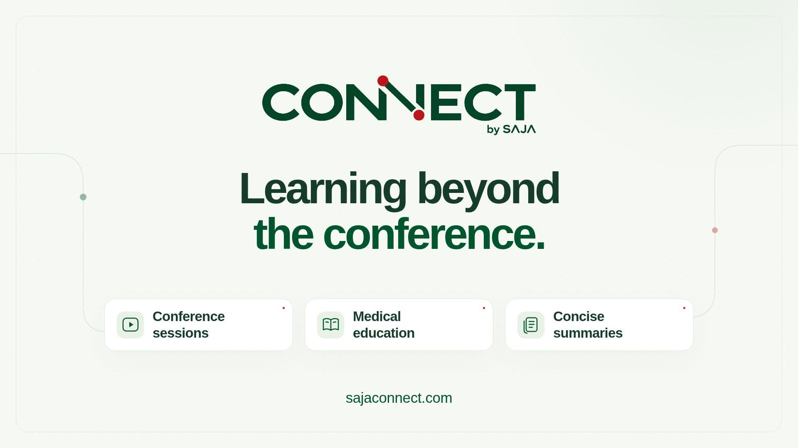
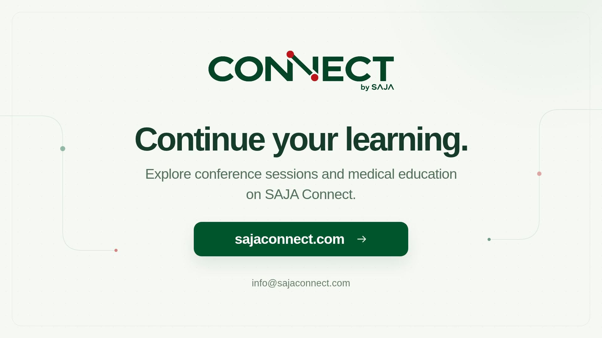

# SAJA Connect intro and outro — review v1

Promotes conference sessions and medical education available at https://sajaconnect.com/.

- [Combined intro + outro preview (16 seconds)](review.mp4)
- [Intro (8 seconds)](intro.mp4)
- [Outro (8 seconds)](outro.mp4)

## Intro

“Learning beyond the conference.” Followed by Conference sessions, Medical education, and Concise summaries, with sajaconnect.com.

## Outro

“Continue your learning.” Followed by an invitation to explore conference sessions and medical education on SAJA Connect, the website, and info@sajaconnect.com. The email comes from the website's public contact page.

Both samples are 1920 × 1080 at 30 fps, with H.264 video and AAC sound. The logo asset is a transparent recreation from the supplied screenshot for style review. Replace it with the original brand asset before final production if a vector or transparent original is available.

These are approval samples. They have not been applied to the 14 conference videos. The next stages, in order, are one case-focused PDF visual for style approval, one two-minute educational video for approval, then production for all sessions.

## Edit the animation

This folder contains the Remotion source. Run `npm install`, then `npm run dev`. The final MP4 samples include a soft original electronic sound bed; rendering the source alone produces the visual animation.
